# Cogpit

<picture>
  <source media="(prefers-color-scheme: dark)" srcset="docs/images/banner_dark.png">
  <source media="(prefers-color-scheme: light)" srcset="docs/images/banner_light.png">
  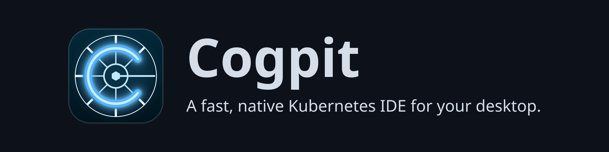
</picture>

[](https://github.com/guided-traffic/cogpit/actions)
[](https://github.com/guided-traffic/cogpit)
[](LICENSE)

**A fast, native Kubernetes IDE for your desktop: your workloads, config, network, storage and
custom resources in one window, a UI that reads from a live cache, and AI agents that work with
you, not behind your back.**

Cogpit gives every standard Kubernetes object, every custom resource your cluster serves, Helm,
Flux CD and Argo CD a navigator, searchable lists, detail drawers, actions and shortcuts, in an
open-source app written in Go. Every list reads from a cache that the cluster's watches keep
current, so lists of 10,000 pods stay quick and opening a view again costs your API server
nothing. And every action is also a tool an agent can use over MCP, with you deciding what it may
change.

<picture>
  <source media="(prefers-color-scheme: dark)" srcset="docs/images/hero_dark.png">
  <source media="(prefers-color-scheme: light)" srcset="docs/images/hero_light.png">
  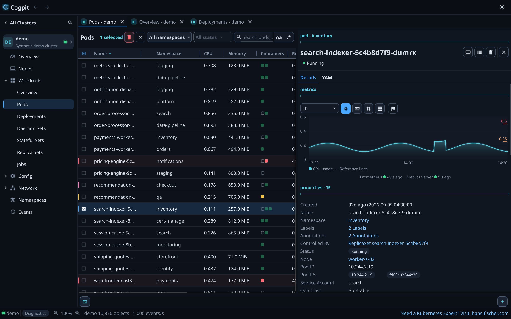
</picture>

> **Pre-alpha.** Cogpit runs on macOS on Apple silicon and, from the release after v0.32.0, on
> Debian and Ubuntu (amd64 and arm64); Windows is planned after the macOS beta. The views and actions are in place, some of them still in part, but nothing has
> been walked through by testers on real clusters yet: try it on a test cluster first. Where it
> stands, feature by feature:
> [ROADMAP.md](ROADMAP.md).

## ✨ Features

### 📋 Every resource, one click from its details

Workloads, config, network, storage, access control and every custom resource your cluster
serves, each in a list you can search (plain, match case or a regular expression) and narrow to
the states you care about: Running, Pending, CrashLoopBackOff, several at once.
Pods and nodes show their CPU and memory from the Metrics Server or Prometheus; a pod's drawer
charts them per container against requests and limits, with Prometheus up to 30 days back
(pictured above).

### 🗺️ The cluster at a glance

The Overview charts CPU, memory and pods of your worker or control-plane nodes over the last hour
or longer, against requests, limits and capacity, and lists what is in trouble right below:
failing pods, unready nodes and workloads, warning events.

<picture>
  <source media="(prefers-color-scheme: dark)" srcset="docs/images/cluster_overview_dark.png">
  <source media="(prefers-color-scheme: light)" srcset="docs/images/cluster_overview_light.png">
  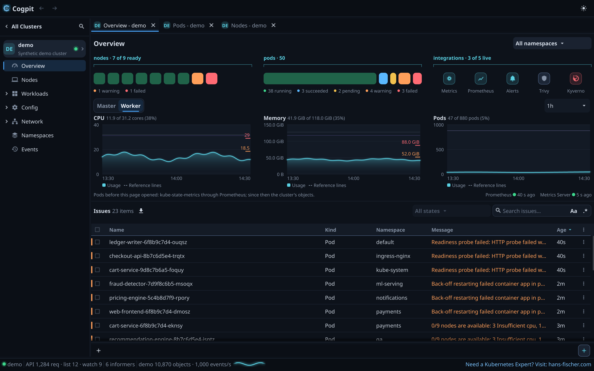
</picture>

### 🖥️ Nodes and what runs on them

Usage bars for CPU, memory and disk (from node-exporter) in the Nodes list; a node's drawer shows
its capacity and the pods running on it with their CPU and memory. Cordon it, drain it (a drain
can be finished even if Cogpit quits halfway) or open a shell on it; the drain and the shell ask
first.

<picture>
  <source media="(prefers-color-scheme: dark)" srcset="docs/images/nodes_dark.png">
  <source media="(prefers-color-scheme: light)" srcset="docs/images/nodes_light.png">
  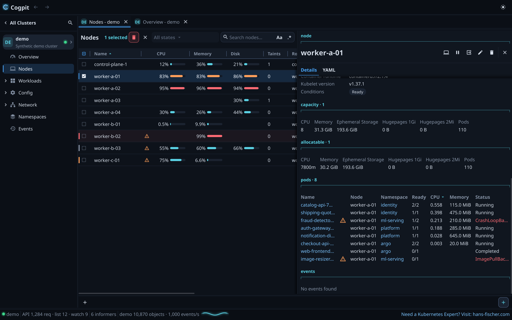
</picture>

### 📜 Logs that follow a whole Deployment

Follow one container, or every pod of a Deployment, Stateful Set or Job in a single tab, each line
marked with its pod and container. Search highlights or filters; timestamps, the previous
container, older lines and a jump to a point in time are one click away.

<picture>
  <source media="(prefers-color-scheme: dark)" srcset="docs/images/logs_dark.png">
  <source media="(prefers-color-scheme: light)" srcset="docs/images/logs_light.png">
  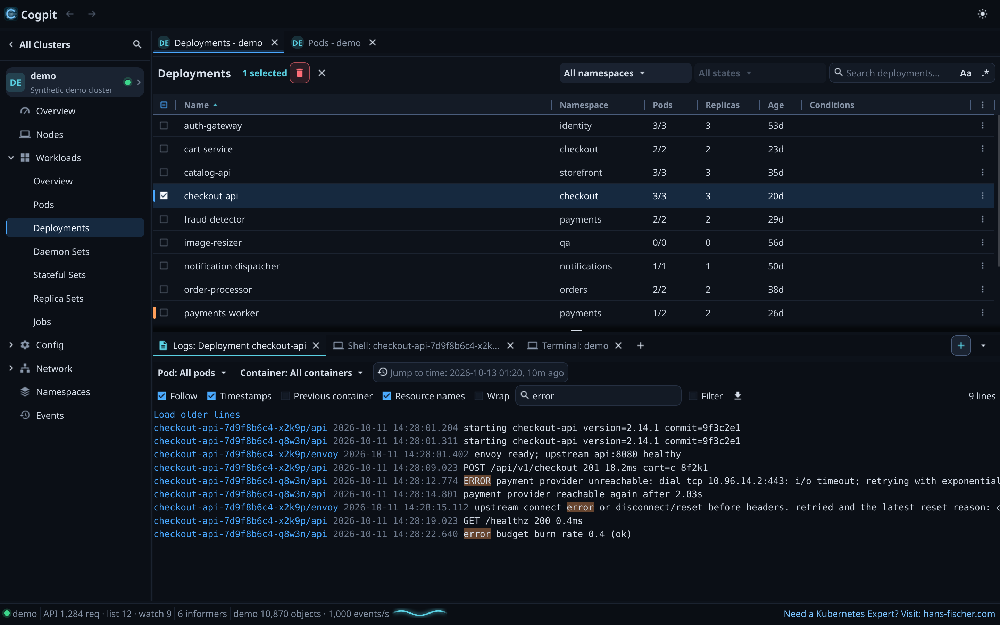
</picture>

### 💻 Shells and a terminal

Open a shell in any container, attach to it, or open a terminal bound to the cluster's context.
Cogpit checks your `kubectl` against the cluster's version and offers a matching download,
verified against the Kubernetes release's signature, when yours is missing or too far off.

<picture>
  <source media="(prefers-color-scheme: dark)" srcset="docs/images/shell_dark.png">
  <source media="(prefers-color-scheme: light)" srcset="docs/images/shell_light.png">
  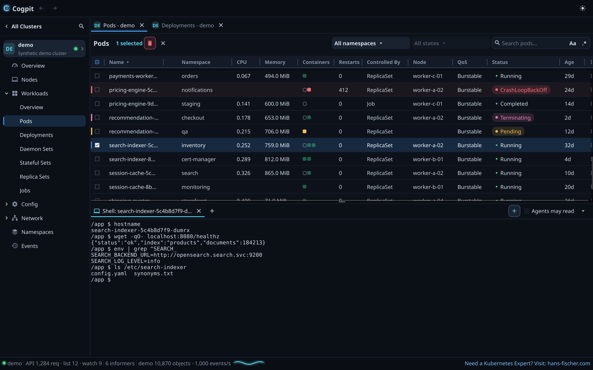
</picture>

### ✏️ Edit YAML, see the diff, then apply

Edit any object in place. Before anything reaches the cluster you see the diff and the API
server's dry-run verdict, and if someone changed the object in the meantime, Cogpit tells you
instead of overwriting their change. Unsaved edits survive a crash.

<picture>
  <source media="(prefers-color-scheme: dark)" srcset="docs/images/edit_diff_dark.png">
  <source media="(prefers-color-scheme: light)" srcset="docs/images/edit_diff_light.png">
  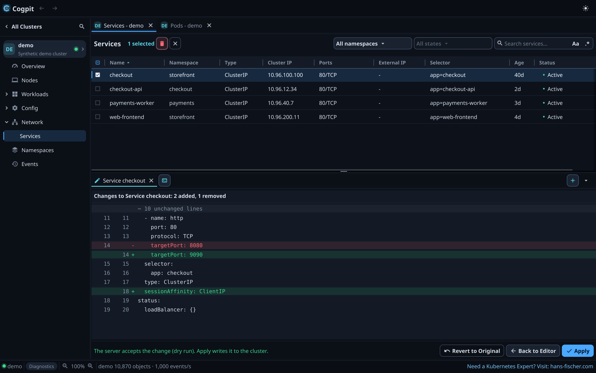
</picture>

### ⎈ Helm, without the helm binary

Browse the charts of the repositories you already added with `helm repo add`, with their icons,
versions and each version's README, and install from a tab. Your releases show their history,
values and notes; upgrade to a newer chart version, roll back or uninstall, all through the Helm
SDK.

<picture>
  <source media="(prefers-color-scheme: dark)" srcset="docs/images/helm_charts_dark.png">
  <source media="(prefers-color-scheme: light)" srcset="docs/images/helm_charts_light.png">
  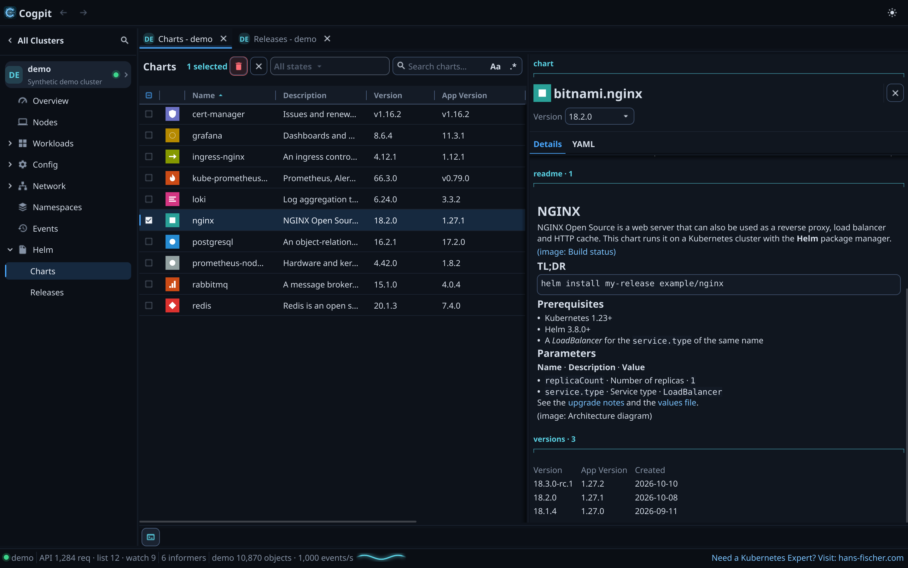
</picture>

<picture>
  <source media="(prefers-color-scheme: dark)" srcset="docs/images/helm_upgrade_dark.png">
  <source media="(prefers-color-scheme: light)" srcset="docs/images/helm_upgrade_light.png">
  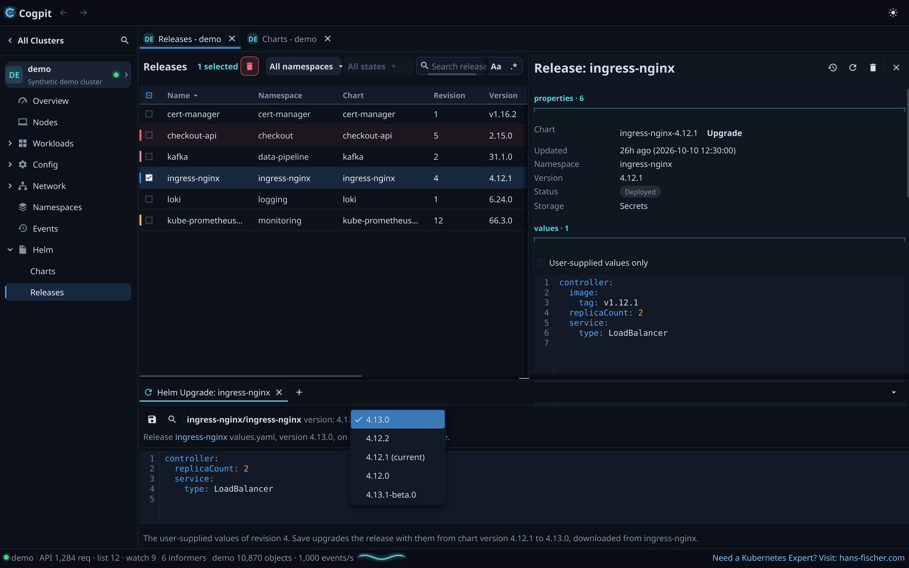
</picture>

### 🔁 GitOps: Flux CD and Argo CD

Flux CD gets its own section: a dashboard of every Flux kind's state and what is not ready, with
Reconcile (with its source), Reset, Suspend and Resume on one object or a whole selection. Argo CD
shows your Applications' sync and health, the recent activity and what needs attention, with Sync,
Refresh and a way into the Argo CD UI.

<picture>
  <source media="(prefers-color-scheme: dark)" srcset="docs/images/flux_dark.png">
  <source media="(prefers-color-scheme: light)" srcset="docs/images/flux_light.png">
  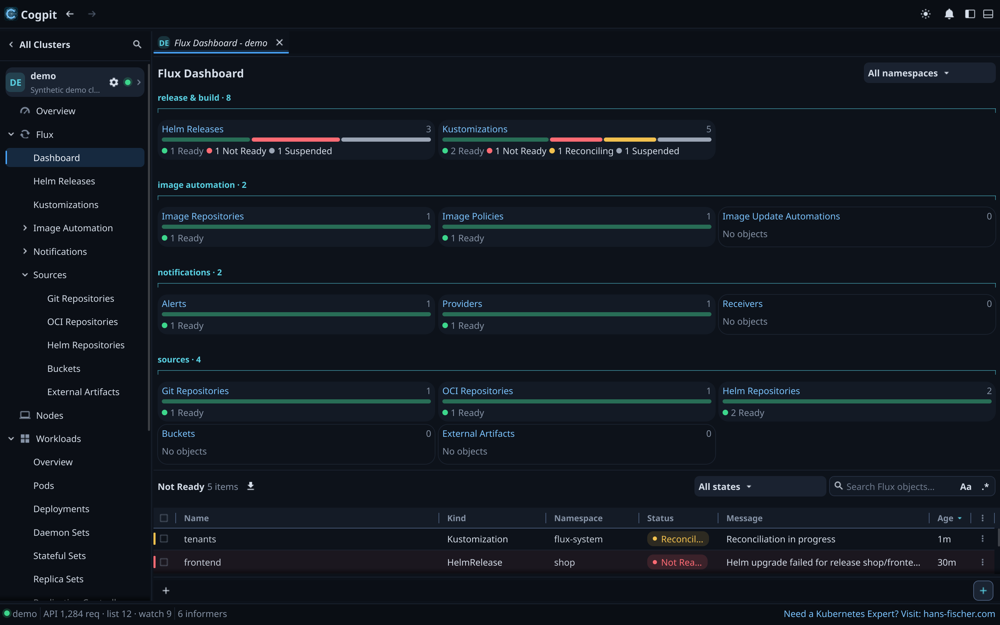
</picture>

<picture>
  <source media="(prefers-color-scheme: dark)" srcset="docs/images/argocd_dark.png">
  <source media="(prefers-color-scheme: light)" srcset="docs/images/argocd_light.png">
  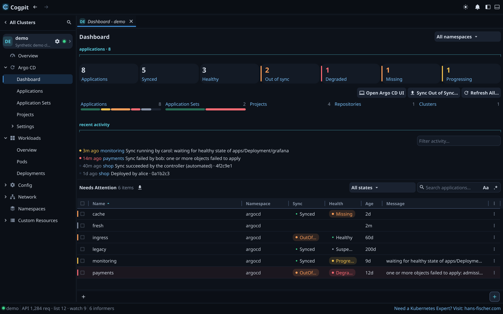
</picture>

### 🗂️ All your clusters in one window

Cogpit reads every kubeconfig in `~/.kube` and the files and folders you add, each on its own, and
follows their changes. Pin clusters to the hotbar (F1–F12), keep tabs of several clusters open
(they come back after a restart), and reach any view, action or cluster from the command palette
(⌘⇧P).

<picture>
  <source media="(prefers-color-scheme: dark)" srcset="docs/images/clusters_dark.png">
  <source media="(prefers-color-scheme: light)" srcset="docs/images/clusters_light.png">
  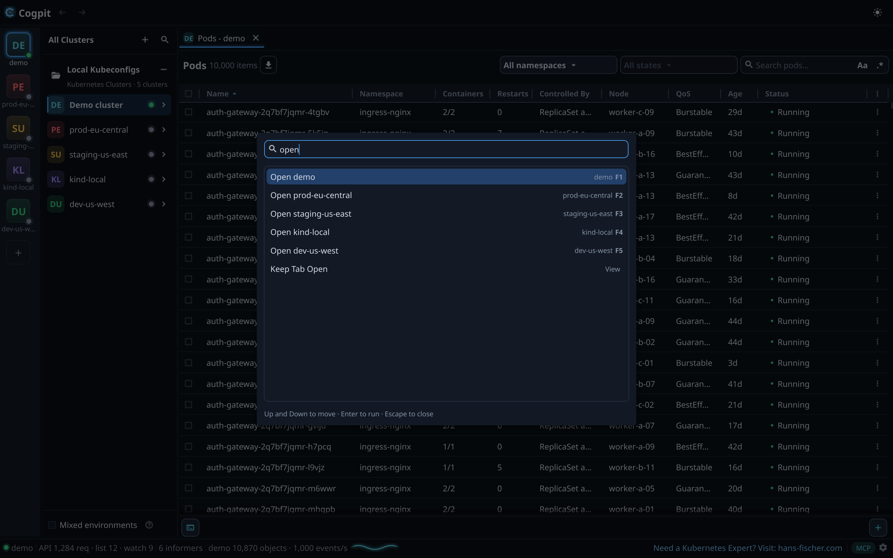
</picture>

### 🔏 Certificates, decoded

A Secret's drawer decodes every certificate in it, PEM or DER: subject, issuer, names, validity
with a warning 30 days before it ends, key usage and fingerprints. Cogpit also checks that
`tls.key` belongs to `tls.crt` and that the chain is in order, without ever showing the key.

<picture>
  <source media="(prefers-color-scheme: dark)" srcset="docs/images/certificates_dark.png">
  <source media="(prefers-color-scheme: light)" srcset="docs/images/certificates_light.png">
  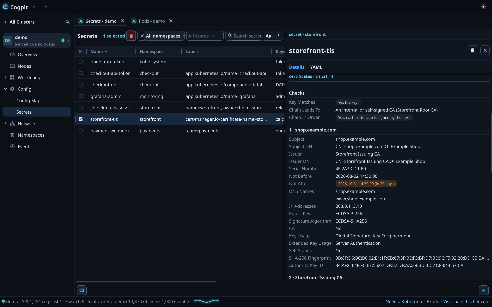
</picture>

### 🤖 Agents over MCP, with you in control

Every command in Cogpit is also an MCP tool, so an agent such as Claude Code sees what you see,
reads lists and logs, and navigates the window for you. Reading is free; a change waits for your OK
in Cogpit's window, which names the objects, the namespace and the cluster (unless you allowed
changes on that cluster; destructive ones always wait), and Help › Audit Log shows everything
agents did. A few commands, such as creating a Secret, only you can run.

<picture>
  <source media="(prefers-color-scheme: dark)" srcset="docs/images/agents_dark.png">
  <source media="(prefers-color-scheme: light)" srcset="docs/images/agents_light.png">
  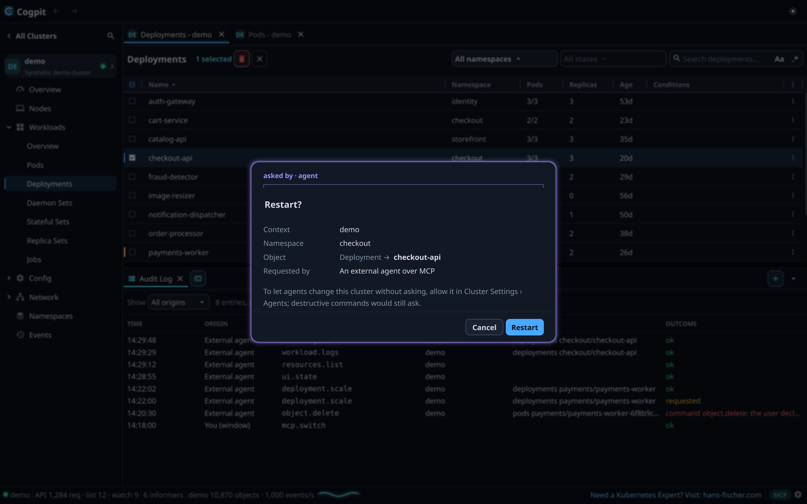
</picture>

### 💬 An agent chat in the window

Cogpit has an agent of its own: a chat column at the window's right edge (⌘I) that talks to a
model you choose, LM Studio on your Mac, a LiteLLM proxy or Open WebUI. Ask about the pod you
selected and it reads the object and its logs and answers in Markdown, tables included; each of its
tool calls is a row you can open, a change waits for your OK as an MCP agent's does, and what a
turn sent to the model is one click away. Escape or ⌘. stops it at any time.

<picture>
  <source media="(prefers-color-scheme: dark)" srcset="docs/images/agent_chat_dark.png">
  <source media="(prefers-color-scheme: light)" srcset="docs/images/agent_chat_light.png">
  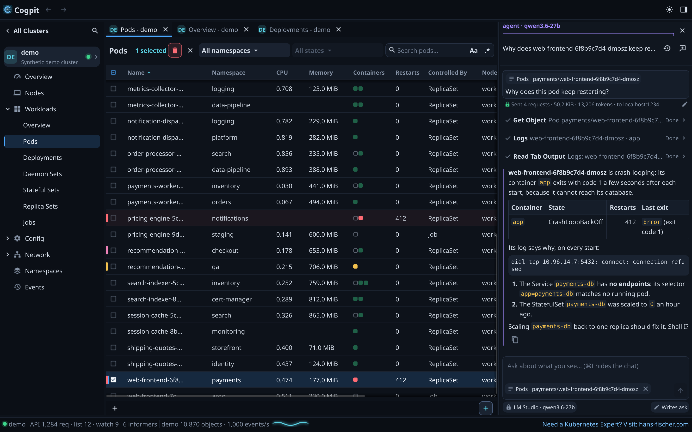
</picture>

### 🌗 Dark or light

Solarized dark or light, or following your Mac's appearance, switched live in Preferences; every
time in your own time zone and your region's format. The pictures on this page follow your light or
dark theme too.

## 🛡️ Safe by design

- **Never surprises a cluster.** Browsing never writes, Cogpit installs nothing into your clusters
  unless you ask it to, and it never writes your kubeconfig files.
- **Asks before it destroys.** Delete, drain, evict, scale to zero, Helm rollback and uninstall
  and the node shell always ask first, naming the objects, the namespace and the cluster.
- **Agents ask too.** Agents read and navigate freely; anything they would change waits for your
  acceptance unless you allowed changes on that cluster, and destructive actions always wait.
- **Everything agents do is logged**, readable in Help › Audit Log.
- **Secrets stay secret.** Values stay masked until you reveal them, agents never read them (where
  a log prints a value of a Secret Cogpit holds, an agent reads a placeholder) unless you mark the
  built-in agent's connection private (a local model or a private cloud), and tokens and keys never
  reach a log.
- **Your credentials stay yours.** Cogpit authenticates the way `kubectl` does, with your
  kubeconfig, and runs a credential plugin only after you allowed it.
- **Light on the API server.** Views read from a watch-fed cache: opening a view again costs no
  request.

## 🚀 Get Cogpit

**Download** the latest [release](https://github.com/guided-traffic/cogpit/releases):
`Cogpit-<version>-macos-arm64.dmg`, Cogpit for Apple silicon, signed and notarized by Apple. Open it
and drag Cogpit into Applications.

**On Linux** (Debian 13, Ubuntu 24.04 or later; from the release after v0.32.0 on), download
`cogpit_<version>_amd64.deb` (or `_arm64.deb`) from the same release and install it:

```sh
sudo apt install ./cogpit_<version>_amd64.deb
```

The package also sets up Cogpit's signed APT repository, so `apt` and the Software Updater offer
every new release, and Cogpit's own Update button installs it after your password. Whether updates
install by themselves is your system's setting, never Cogpit's
([installing on Linux](docs/developer/usage.md#install-on-linux)).

**`cogpit-cli` comes inside the app**, at `/Applications/Cogpit.app/Contents/MacOS/cogpit-cli`
(in the Linux package at `/usr/bin/cogpit-cli`): it lists your contexts, prints any kind's objects
as Cogpit's views show them, and connects agents to Cogpit's MCP tools. Help › Copy MCP command
gives you the one command that registers it with Claude Code, once
([reference](docs/developer/usage.md#cogpit-cli)).

**Build from source** with Go and the Xcode Command Line Tools (on Linux a C compiler and the GL,
X11 and Wayland headers): `make run-demo` starts a development build on its synthetic demo cluster
([run from source](docs/developer/usage.md#run-the-mvp)).

## 📚 Documentation

| Document | For |
|---|---|
| [Usage and reference](docs/developer/usage.md) | Running Cogpit, its flags and files, setting up an agent, `cogpit-cli` |
| [Commands and MCP tools](docs/developer/commands.md) | Every command an agent can call, with its danger level |
| [Developer documentation](docs/developer/README.md) | Architecture, conventions, testing, releasing, decisions |
| [Security architecture](docs/security/README.md) | Trust boundaries, credentials, privilege footprint, agents and MCP |
| [Progress](docs/parity/README.md) | What exists and what is missing, view by view |
| [ROADMAP.md](ROADMAP.md) | Where Cogpit stands and what comes next |
| [SECURITY.md](SECURITY.md) | Reporting a vulnerability |
| [AGENTS.md](AGENTS.md) | Contributing, for people and coding agents |

## License

[Apache-2.0](LICENSE). Cogpit is an independent project: it contains no code, text or assets from
other Kubernetes IDEs and is not affiliated with their makers. Third-party material, including the documentation method
adapted from PhotoCraft, is listed in [ATTRIBUTION.md](ATTRIBUTION.md).
