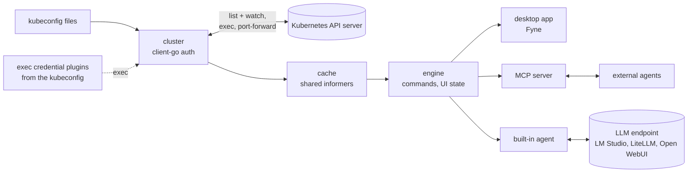

# Developer documentation

For contributors and agents. Start with [`AGENTS.md`](../../AGENTS.md) for the rules in short, then
this page.

## What has to be in your head first

1. **A local MVP is built** (2026-10-11) and grew in the runs since: every view and action of
   Lens's list at least in part, the custom resource views from the cache, Helm, Flux CD and
   Argo CD, logs, terminals and shells, CI and releases, and MCP control through
   [227 commands](commands.md) (2026-10-25, on the branch `proto/helm-revisions`; 223 on main); it doubled as the [Fyne spike](spike-fyne.md#results). What exists and
   where it differs from the plan: [architecture › Current state](architecture.md#current-state-2026-10-19).
2. **Go and Fyne.** The engine is Go on client-go, the kubectl libraries and the Helm SDK. The UI
   is Fyne: the [spike](spike-fyne.md) passed and D-1 is decided; re-checks on Windows and Linux
   can still move one platform's UI to a Rust/egui process ([decisions](decisions.md#d-1-ui-toolkit)).
3. **Cache first.** Only the cache layer lists and watches; the UI and agents read from the cache
   ([architecture §5](architecture.md#5-cache)).
4. **Everything is a command, and every command is an MCP tool.** The GUI, the CLI, external agents
   and the built-in agent dispatch the same commands; UI state lives in the engine, so agents can
   see and drive the UI.
5. **Never surprise a cluster.** Confirmations and verbs are enforced in the engine for every
   origin ([conventions](conventions.md#never-surprise-a-cluster)).

## Pages

| Page | Topic |
|---|---|
| [`usage.md`](usage.md) | The reference from the root README (moved 2026-10-14): status, features in detail, download and run, the agent set-up, the flags of `cogpit` and `cogpit-cli`, preferences, naming conventions, make targets |
| [`commands.md`](commands.md) | Every command and MCP tool with its danger and parameters, generated from the registry |
| [`architecture.md`](architecture.md) | Goals, principles, packages, layering, the UI seam, the cache, MCP and the agent, runtime model |
| [`conventions.md`](conventions.md) | Clean-room, never surprise a cluster, cache first, crash stance, secrets, style, commits |
| [`extending.md`](extending.md) | Checklists: a command, a kind profile, a cache consumer, a package |
| [`testing.md`](testing.md) | Test tiers, fixtures, performance and API-load budgets |
| [`ui-threads.md`](ui-threads.md) | Every place the GUI's code runs off Fyne's main goroutine, and why it is safe (D-103's audit, kept by a test) |
| [`releasing.md`](releasing.md) | CI jobs and their make targets, the race shards, coverage, Renovate, the release flow with semantic-release, the release pipeline and its artifacts, the macOS signing and notarization and what to do when it fails, signed updates |
| [`decisions.md`](decisions.md) | Decisions taken and open |
| [`spike-fyne.md`](spike-fyne.md) | The UI toolkit gate before M2 |
| [`design-language.md`](design-language.md) | Dark Cockpit, the design prototype of the branch `design-prototype`: principles, palette, shapes, what each part of the window looks like |

Where Cogpit stands against Lens: [`../parity/`](../parity/README.md). Security architecture:
[`../security/`](../security/README.md).

## Repository layout

```text
cogpit/
├─ AGENTS.md, CLAUDE.md, ATTRIBUTION.md, README.md, ROADMAP.md, SECURITY.md, LICENSE
├─ go.mod                     module github.com/guided-traffic/cogpit
├─ Makefile                   build, run, test targets (one per CI job), lint, parity, gosec, vuln, cyclo, kind-up, kind-down, app, dist-* (releasing.md)
├─ .golangci.yml              linters and the depguard layering rules
├─ .github/                   workflows: release (the checks, semantic-release), build (the release pipeline), renovate, rerun (re-runs jobs that failed setting up); actions/go-setup; renovate.json; the coverage badge
├─ .releaserc.json            semantic-release config; package.json pins its npm tooling (CI only)
├─ cmd/cogpit/                desktop app (Fyne, cgo)
├─ cmd/cogpit-cli/            headless CLI: contexts, get, the MCP stdio bridge (pure Go)
├─ internal/                  packages, layered L0–L4 (architecture.md §2–§3)
├─ hack/kind/                 kind cluster configs, seed manifests (make kind-up; the drain cluster: make kind-drain-up), Prometheus and kube-prometheus-stack values (make kind-prometheus, make kind-kps), Trivy Operator's values and test workloads (make kind-trivy)
├─ hack/icon/                 generator of the app icon (make icon; internal/ui/logo draws it)
├─ hack/showcase/             oxipng.sh: the pinned oxipng and its lossless run over docs/images (make showcase)
├─ hack/parity/               make parity: checks the parity checklists and counts what they report
├─ hack/shard/                the UI's tests split into shards: CI's race jobs (make test-race-ui), run in parallel locally (make test-ui), the tests -race skips (make test-norace-coverage)
├─ hack/coverage/             merges coverage profiles into the badge and the summary (make coverage-report)
├─ hack/readmecmds/           the command table in docs/developer/commands.md, from the registry
├─ hack/macos/                release.sh: signs, images and notarizes the macOS downloads (make dist-macos; releasing.md)
├─ hack/appcast/              drafts and checks Sparkle's appcast (make appcast-draft, appcast-verify; releasing.md)
├─ hack/sigstoreroot/         refreshes the sigstore trusted root internal/kubectl embeds (make sigstore-root, D-50)
├─ hack/k8seol/               refreshes the Kubernetes release table internal/model/k8seol embeds (make k8s-eol; the release pipeline before it builds, D-91)
├─ hack/ci/                   apt-install.sh: CI's apt-get with deadlines and tries
├─ third_party/fyne-terminal/ the patched copy of fyne-io/terminal (D-14; PATCHES.md), a module of its own (make test-fork)
├─ packaging/                 icon.png (no per-OS packaging yet: M11)
└─ docs/
   ├─ developer/              this directory; assets/logo holds every version of the logo (D-24)
   ├─ images/                 showcase renders for the README, <name>_dark.png and <name>_light.png (make showcase)
   ├─ parity/                 progress against Lens
   └─ security/               security architecture, one page per perspective
```

## Packages

| Package | Layer | Responsibility |
|---|---|---|
| `internal/model`, `internal/model/kinds` | L0 | Object refs, rows, status tokens, the time and byte formats; the kind profiles (46 built-in, the local kinds Port Forwarding and Helm Charts, the curated ones of Flux CD, Argo CD and the Vertical Pod Autoscalers, the virtual kinds Applications and Argo CD's repositories and clusters); pure |
| `internal/model/k8seol` | L0 | The Kubernetes release table built in (`releases.json`, `make k8s-eol`): a version's upstream end of life, maintenance mode, the estimate beyond the table, the kubelet's version skew ([D-91](decisions.md#d-91-the-kubernetes-version-and-upstream-end-of-life)) |
| `internal/kubeconfig` | L0 | Kubeconfig discovery, merge and validation from bytes |
| `internal/buildinfo` | L0 | The version both binaries report: a release's, set by the linker, else `dev` and the commit ([releasing](releasing.md#the-version-a-build-reports)) |
| `internal/cluster` | L1 | Connections: client-go config, auth, cached discovery, access reviews |
| `internal/cache` | L1 | Shared informers, reference counting, warm period, transforms, request counters |
| `internal/terminal` | L1 | PTY sessions: local shell with its own kubeconfig, pod exec and attach |
| `internal/kubectl` | L1 | kubectl for terminals (2026-10-13, [D-3](decisions.md#d-3-helm-and-kubectl-binaries)): a binary's client version (`Prober`), the skew rule, the releases in the directory for binaries, the download from dl.k8s.io or a mirror verified against the published SHA-256 and the release's sigstore signature, since 2026-10-15 with sigstore-go and the signature's Rekor entry (`Downloader`, `Verifier`, `rekor.go`, [D-50](decisions.md#d-50-kubectls-signature-check)); the release host and `rekor.sigstore.dev` only, never an API server |
| `internal/locale` | L1 | The computer's date and time format: macOS's region through CoreFoundation, else the environment's locale ([D-31](decisions.md#d-31-every-timestamp-in-the-local-time-zone-and-format)) |
| `internal/helm` | L2 | Helm on the SDK, in-process: the releases from the cached Secrets and ConfigMaps, chart repositories from Helm's `repositories.yaml`, install, upgrade, rollback and uninstall, crash-safe through the engine's journal ([architecture §8](architecture.md#8-helm-internalhelm)) |
| `internal/metrics` | L2 | Metrics providers (the Metrics Server and Prometheus through the API server's service proxy, together), the hub that polls while subscribed, its TTL cache and series ([architecture §9](architecture.md#9-metrics-internalmetrics)) |
| `internal/alerting` | L2 | The cluster's Alertmanager: found among the cached Services by name or at the address set, its active alerts polled through the API server's service proxy while the engine makes the poller active, bounded and classified by severity ([architecture §9 › Alertmanager](architecture.md#alertmanager-internalalerting-d-77), [D-77](decisions.md#d-77-alertmanager-the-alerts-pill-and-the-alert-board)) |
| `internal/demo` | L2 | The synthetic demo cluster behind a `cache.Source`, and its synthetic Metrics Server (a `metrics.Provider`: demo and metrics are both L2, so the import is allowed); development builds only: its one importer, `engine/connector_demo.go`, is left out by the release's tag `nodemo` ([D-67](decisions.md#d-67-the-demo-cluster-stays-out-of-releases)) |
| `internal/engine`, `internal/engine/commands` | L3 | Session, command registry, UI state, snapshots, drawer, streams, confirmation, audit log; the commands one file per area |
| `internal/mcp` | L4 | MCP server over the registry |
| `internal/app` | L4 | The wiring both binaries share (2026-10-13): Cogpit's directories, the kubeconfig sources (so the app and `cogpit-cli` offer the same contexts and honour the same plugin approvals), the audit log |
| `internal/agent` | L4 | The built-in agent (2026-10-14, [D-10](decisions.md#d-10-built-in-agent)): `engine.ChatAgent` over OpenAI-compatible Chat Completions endpoints on plain `net/http`, its connections and owner-only key file, the turn loop dispatching commands with origin `builtInAgent` ([architecture §7](architecture.md#7-mcp-and-the-built-in-agent)) |
| `internal/update` | L4 | The macOS app's updater (2026-10-14): Sparkle 2 loaded at run time from the bundle through cgo, its reasons when there is none ([architecture §11](architecture.md#11-updates-internalupdate)) |
| `internal/ui/fyneui` | L4 | The Fyne shell, the chat column included; `yamlview` the YAML viewer and editor, `termview` the terminal and log widgets |
| `internal/ui/logo` | L4 | The logo ([D-24](decisions.md#d-24-logo)), every version of it (`Versions`, `Current`), rasterised for the app icon (`hack/icon`) and the GUI's tile (header, welcome page, About, the README's banner); imports no Fyne |
| `internal/ui/nativedialog` | L4 | The system's file panels: on macOS NSOpenPanel and NSSavePanel as a sheet on a window, through cgo (elsewhere `ErrUnsupported`, and the caller shows its own dialog), and the owner-only store of the security-scoped bookmarks of what the user picked in them (`bookmarks.json`); imports no Fyne |
| `internal/testkit` | – | In-memory source, fake API server, object builders, a local kubectl release host (`KubectlReleases`); `enginekit/` the real engine over an in-memory source for the window's tests, `fakellm/` a fake OpenAI-compatible endpoint for the agent's, `sigstoretest/` a sigstore instance of the tests' own; `integration/` holds cross-package and kind tests; imported by tests only (depguard's `no-testkit-in-product`) |

## Data flow

From the kubeconfig files to the API server, the cache, the engine and what reads it (moved from
the root README on 2026-10-14):



## Core flows, one fact each

- **Connect:** the user picks a context; `cluster` builds a client-go config from the kubeconfig,
  runs cached discovery and access reviews, and the sidebar shows the kinds the cluster serves and
  the user may list.
- **Browse:** a view acquires a cache handle; the informer lists once and then watches; the engine
  turns cache changes into snapshots, at most ten per second per view.
- **Act:** a menu item, shortcut, CLI call or agent tool call dispatches a command; the engine
  checks `enabled`, permissions and the origin's confirmation rule, then runs it.
- **Agent:** an agent reads `ui_state` to know what the user sees, finds objects in the cache and
  calls `ui_navigate` to show them.

## Build, test, lint

Through the `Makefile`, as in the team's other repositories (`make help` lists every target):

| Task | Command |
|---|---|
| Build | `make build` (a development build, with the demo cluster; `GO_TAGS=nodemo` builds a release's variant) |
| Run the app | `make run` (kind cluster), `make run-demo` (demo cluster), `bin/cogpit` (your kubeconfig) |
| Unit tests with the race detector | `make test-unit-race` (the UI's package in eight parallel shards) |
| The UI's tests alone, fast | `make test-ui` (eight shards, as many at once as the CPUs and memory allow: about a minute on an M1 Ultra), `make test-ui-race` (about six) |
| Cluster tests | `make kind-up && make test-kind` |
| Envtest tests (a real kube-apiserver and etcd, no Docker) | `make test-envtest` |
| Benchmarks of the gate | `make bench` |
| Lint, layering included | `make lint` (golangci-lint v2.15.0, installed into `bin/`) |
| Package for macOS | `make app` |
| The macOS download, the disk image with `cogpit-cli` inside the app, signed ad-hoc (the release pipeline signs with the Developer ID) | `make dist-app` then `make dist-macos MACOS_SIGN=adhoc` ([releasing](releasing.md#running-the-signing-locally)) |
| Check the parity checklists and their numbers | `make parity` ([rules](../parity/README.md#make-parity)) |
| Render the README's pictures, dark and light, and optimise them losslessly | `make showcase` ([testing](testing.md#tiers)) |
| Regenerate the parity checklist page | `go run ./hack/parity` (`make parity` refuses a stale one) |
| Measure the performance and API-load budgets, write the scorecard | `make scorecard`, on a quiet machine, then commit `docs/parity/scorecard.md` ([testing](testing.md#performance-budgets-proposed-not-measured)) |

The tools in `bin/` (golangci-lint, gocyclo, govulncheck, fyne) are built with the Go of `go.mod`
and built again when their pin or that Go changes, so a local check runs the version CI runs
([AGENTS.md rule 12](../../AGENTS.md#the-other-rules)); format with `make fmt`, not a `gofmt` from
`PATH`, which may belong to another Go.

**A warning every macOS build prints, harmless:** `ld: warning: ignoring duplicate libraries:
'-lobjc'`. The go command adds `-lobjc` to the link for every cgo package with Objective-C files
(Cogpit has several, Fyne's GLFW one more), and Apple's linker since Xcode 15 reports the repeat:
[golang/go#67799](https://github.com/golang/go/issues/67799), open as of 2026-10-24, seen with
Xcode 27.1's linker (ld-27037.1). It is left visible rather than silenced with
`-Wl,-no_warn_duplicate_libraries`, which would hide every other duplicate library too.
