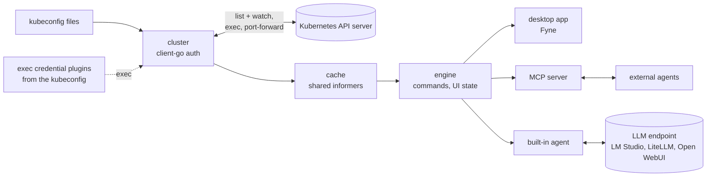

# Developer documentation

For contributors and agents. Start with [`AGENTS.md`](../../AGENTS.md) for the rules in short, then
this page.

## What has to be in your head first

1. **Where it stands.** Every Lens resource view and action exists, most of them in part
   ([parity checklist](../parity/parity-checklist.md)), with custom resource views from the cache,
   Helm, Flux CD, Argo CD, logs, terminals and shells, released for macOS, Linux and Windows. Per
   feature: [ROADMAP.md](../../ROADMAP.md); what runs where:
   [architecture](architecture.md#what-runs-where).
2. **Go and Fyne.** The engine is Go on client-go, the kubectl libraries and the Helm SDK. The UI is
   Fyne ([D-1](decisions.md#d-1-ui-toolkit)); a platform whose re-check fails would move only its UI
   to a Rust/egui process behind the same engine seam.
3. **Cache first.** Only the cache layer lists and watches; the UI and agents read from the cache
   ([architecture §5](architecture.md#5-cache)).
4. **Everything is a command, and every command is an MCP tool.** The GUI, `cogpit-cli`, external
   agents and the built-in agent dispatch the same commands ([commands.md](commands.md)); UI state
   lives in the engine, so agents can see and drive the UI.
5. **Never surprise a cluster.** Verbs, danger levels and confirmations are enforced in the engine
   for every origin ([conventions](conventions.md#never-surprise-a-cluster)).
6. **The layering is enforced.** `depguard` in `make lint`: a package imports only lower layers,
   and only `internal/ui/...` imports Fyne
   ([architecture §3](architecture.md#3-dependency-layering-enforced)).

## Pages

| Page | Topic |
|---|---|
| [`usage.md`](usage.md) | What a user sees and does: download and install per platform, run from source, an agent's set-up, the flags of `cogpit` and `cogpit-cli`, every Preferences and Cluster Settings entry, broken connections and waiting logins, files and naming conventions, make targets |
| [`commands.md`](commands.md) | Every command and MCP tool with its danger and parameters, generated from the registry (`go run ./hack/readmecmds`) |
| [`architecture.md`](architecture.md) | What runs where, packages and layering, the engine/UI seam, the cache, cluster connections and kubeconfig sources, MCP and the built-in agent, Helm, metrics, terminals, updates, the runtime model |
| [`conventions.md`](conventions.md) | Clean-room, never surprise a cluster, cache first, crash stance, secrets, commands, tests, style, UI, decisions, documentation, commits |
| [`extending.md`](extending.md) | Checklists: a command, an integration, a kind profile, a cache consumer, a package, the logo |
| [`testing.md`](testing.md) | Test tiers, fixtures, asynchronous results, Windows, performance and API-load budgets, the checks before a pull request |
| [`ui-threads.md`](ui-threads.md) | Every place the GUI's code runs off Fyne's main goroutine and why it is safe ([D-103](decisions.md#d-103-fynes-thread-check-a-build-parameter-off-in-releases)), kept complete by `TestEveryGoroutineSiteIsAudited` |
| [`releasing.md`](releasing.md) | CI jobs and their make targets, the UI's test shards, coverage, Renovate, the release flow with semantic-release, the release pipeline and its artifacts, macOS signing and notarization and what to do when it fails, the Linux and Windows packages, signed updates |
| [`decisions.md`](decisions.md) | Every decision, taken and open, with its reason |
| [`spike-fyne.md`](spike-fyne.md) | What Fyne gives and lacks for Cogpit, from the UI toolkit spike ([D-1](decisions.md#d-1-ui-toolkit)) |
| [`design-language.md`](design-language.md) | Dark Cockpit, Cogpit's visual language ([D-110](decisions.md#d-110-dark-cockpit-cogpits-design-language)): principles, palette, shapes, what each part of the window looks like |

Where Cogpit stands against Lens: [`../parity/`](../parity/README.md). Security architecture:
[`../security/`](../security/README.md). The packages and their layers:
[architecture › Packages](architecture.md#packages).

## Repository layout

```text
cogpit/
├─ AGENTS.md, CLAUDE.md, ATTRIBUTION.md, README.md, ROADMAP.md, SECURITY.md, LICENSE
├─ go.mod                     module github.com/guided-traffic/cogpit
├─ Makefile                   every build, run, test, lint, package and release target (make help)
├─ .golangci.yml              linters and the depguard layering rules
├─ .github/                   workflows release.yml (CI, semantic-release), build.yml (the release pipeline), renovate.yml; actions/go-setup; renovate.json; badges/coverage.json
├─ .releaserc.json            semantic-release config; package.json pins its npm tooling (CI only)
├─ cmd/cogpit/                desktop app (Fyne, cgo)
├─ cmd/cogpit-cli/            headless CLI: contexts, get, version and the MCP stdio bridge (pure Go)
├─ internal/                  the packages, layered L0–L4 (architecture.md §2–§3)
├─ third_party/fyne-terminal/ the patched copy of fyne-io/terminal (D-14; PATCHES.md), a module of its own (make test-fork)
├─ hack/
│  ├─ kind/                   the kind clusters, their seed and optional stacks (make kind-up, kind-drain-up, kind-prometheus …; README.md)
│  ├─ envtest/                fetch.sh: envtest's etcd and kube-apiserver, pinned by SHA-512 (make envtest-bin)
│  ├─ shard/                  the UI's tests in shards balanced by durations/ (make test-ui, test-ui-race, CI's test-race-ui; make ui-durations) and the tests -race skips (make test-norace-coverage)
│  ├─ coverage/               merges coverage profiles into the badge and the summary (make coverage-report)
│  ├─ parity/                 checks the parity checklists and their numbers (make parity); go run ./hack/parity writes docs/parity/parity-checklist.md
│  ├─ scorecard/              make scorecard: the performance and API-load budgets measured into docs/parity/scorecard.md
│  ├─ readmecmds/             the command table in docs/developer/commands.md, from the registry
│  ├─ icon/                   draws the app icon from internal/ui/logo: packaging/icon.png (make icon), the Linux and Windows packages' icons
│  ├─ showcase/               oxipng.sh: the pinned oxipng and its lossless run over docs/images (make showcase)
│  ├─ macos/                  release.sh (signs, images and notarizes the download: make dist-macos), the disk image's template, Sparkle, the appcast
│  ├─ appcast/                drafts and checks the appcasts (make appcast-draft, appcast-verify, appcast-windows-*)
│  ├─ linux/                  the .deb (make dist-linux), the APT repository (make apt-repo, apt-verify), their test (make test-linux-package)
│  ├─ windows/                the setup with NSIS (make dist-windows), its resources, WinSparkle, the appcast, the setup's test, Mesa for its smoke test (make mesa)
│  ├─ smoke.sh                the smoke test: the shipped app's binary started once with --smoke (make smoke)
│  ├─ sigstoreroot/           refreshes the sigstore trusted root internal/kubectl embeds (make sigstore-root, D-50)
│  ├─ k8seol/                 refreshes the Kubernetes release table internal/model/k8seol embeds (make k8s-eol, D-91)
│  └─ ci/                     apt-install.sh (CI's apt-get with deadlines and tries), sha256sums.sh (a release's SHA256SUMS across jobs)
├─ packaging/                 icon.png; dmg/ (the disk image's window), linux/ (launcher, AppStream entry, update helper, polkit action, APT key), windows/ (NSIS script, resources)
└─ docs/
   ├─ developer/              this directory; assets/logo holds every version of the logo (D-24), assets/design-prototype the design's before and after
   ├─ images/                 showcase renders for the README, <name>_dark.png and <name>_light.png (make showcase)
   ├─ parity/                 progress against Lens
   └─ security/               security architecture, one page per perspective
```

## Data flow

From the kubeconfig files to the API server, the cache, the engine and what reads it:



## Core flows, one fact each

- **Connect:** the user picks a context; `cluster` builds a client-go config from the kubeconfig,
  runs cached discovery and access reviews, and the navigator shows the kinds the cluster serves
  and the user may list.
- **Browse:** a view acquires a cache handle; the informer lists once and then watches; the engine
  turns cache changes into snapshots, at most ten per second per view.
- **Act:** a menu item, shortcut, CLI call or agent tool call dispatches a command; the engine
  checks `enabled`, permissions and the origin's confirmation rule, then runs it.
- **Agent:** an agent reads `ui_state` to know what the user sees, finds objects in the cache and
  calls `ui_navigate` to show them.

## Build and test

`make help` lists every target; [usage › Make targets](usage.md#make-targets) says what each does,
[testing](testing.md) covers the test tiers and budgets, [releasing](releasing.md) CI and the
releases. Before a push, check only what the change touches
([AGENTS.md §5](../../AGENTS.md#5-before-you-finish-a-task)); CI is the full gate.

**`ld: warning: ignoring duplicate libraries: '-lobjc'`**, printed by every macOS build, is
harmless: the go command adds `-lobjc` to the link for every cgo package with Objective-C files
(Cogpit has several, Fyne's GLFW one more), and Apple's linker since Xcode 15 reports the repeat
([golang/go#67799](https://github.com/golang/go/issues/67799)). It stays visible:
`-Wl,-no_warn_duplicate_libraries` would hide every other duplicate library too.
